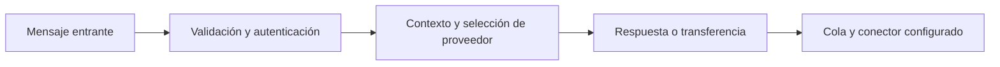

# WhatsApp LLM Chatbot — historical standalone project

[](https://github.com/Pablo-Cubides/chatbot-whatsapp-llm/actions/workflows/ci.yml)

**Estado: proyecto histórico, sin desarrollo de nuevas funcionalidades.** El trabajo de automatización continuó dentro de Cubides Bots. La edición pública mantenida muestra componentes y ejemplos reproducibles en [Cubides_bots_public](https://github.com/Pablo-Cubides/Cubides_bots_public).

Este repositorio conserva la implementación independiente para consulta técnica y correcciones acotadas. No debe interpretarse como un servicio alojado ni como un producto con soporte de producción garantizado.

Los pushes de mantenimiento ejecutan CI, pero no redespliegan automáticamente un servidor antiguo. El job de despliegue requiere la variable de repositorio `ENABLE_LEGACY_DEPLOY=true` además de la configuración existente; déjala sin definir mientras el proyecto siga retirado.

## Qué demuestra

- API en Python/FastAPI con autenticación JWT, permisos y panel de administración.
- Persistencia con SQLAlchemy, PostgreSQL y migraciones Alembic; SQLite para desarrollo.
- Cola de mensajes, caché Redis con fallback y controles de frecuencia.
- Integración con proveedores de LLM y dos vías de WhatsApp: automatización web y Cloud API.
- Pruebas de autenticación, rutas, almacenamiento y componentes de seguridad.



Las integraciones reales necesitan cuentas, credenciales y configuración propias. No hay una demostración pública que envíe mensajes ni se incluyen conversaciones de usuarios.

## Correcciones de mantenimiento

La revisión de octubre de 2026 actualiza las dependencias fijadas con avisos públicos en PyPI: `certifi`, `cryptography`, `soupsieve`, `urllib3` y `aiohttp`. También restaura la entrada de compatibilidad `stub_chat.py` que importaban los routers y el worker, delegando en la implementación de proveedores existente. Las llamadas desde rutas asíncronas se ejecutan fuera del event loop.

Una prueba en un intérprete nuevo comprueba que la aplicación real registra el login, emite un token y mantiene las rutas protegidas. Esto evita que el módulo simulado de los tests oculte un fallo de importación. La revisión no constituye una certificación de seguridad ni confirma que un despliegue antiguo haya sido actualizado.

## Desarrollo local

Requiere Python 3.13. Las imágenes de API y scheduler fijan `python:3.13.16-slim`, con el mismo parche en builder y runtime; CI usa la rama 3.13. PostgreSQL y Redis son recomendables para probar el flujo completo.

```sh
git clone https://github.com/Pablo-Cubides/chatbot-whatsapp-llm.git
cd chatbot-whatsapp-llm
python -m venv .venv
. .venv/bin/activate
python -m pip install -r requirements-dev.txt
```

Configura las variables documentadas en `.env.example` sin subir valores reales. Como mínimo se requieren `JWT_SECRET` y `ADMIN_PASSWORD`. Usa una base de desarrollo y credenciales propias; desactiva la transcripción opcional con `AUDIO_TRANSCRIPTION_ENABLED=false` si no necesitas descargar un modelo de audio.

```sh
alembic upgrade head
python -m uvicorn admin_panel:app --host 127.0.0.1 --port 8003
```

`/healthz` comprueba el estado del servicio. Para verificar autenticación, prueba también `/api/auth/login` y una ruta protegida: un health check por sí solo no valida el funcionamiento de la aplicación.

El worker de automatización web requiere además `requirements-worker.txt`, un navegador compatible y una sesión de WhatsApp autorizada. No se inicia ni envía mensajes automáticamente como parte de las pruebas de mantenimiento.

## Validación

```sh
python -m pytest -q tests/unit/test_unstubbed_runtime.py
python -m pytest -q tests
ruff format --check .
ruff check .
```

Los tests existentes usan dobles para servicios externos. El smoke test de arranque evita específicamente el doble de `stub_chat`; no llama a un proveedor de IA real. Consulta el resultado de CI para el estado de la suite, en lugar de asumir una cifra fija de pruebas o cobertura.

## Documentación

- [Seguridad y alcance del mantenimiento](SECURITY.md)
- [Arquitectura y operaciones](docs/)
- [API y routers](src/routers/)
- [Migraciones](alembic/)
- [Automatizaciones públicas actuales](https://github.com/Pablo-Cubides/Cubides_bots_public)
